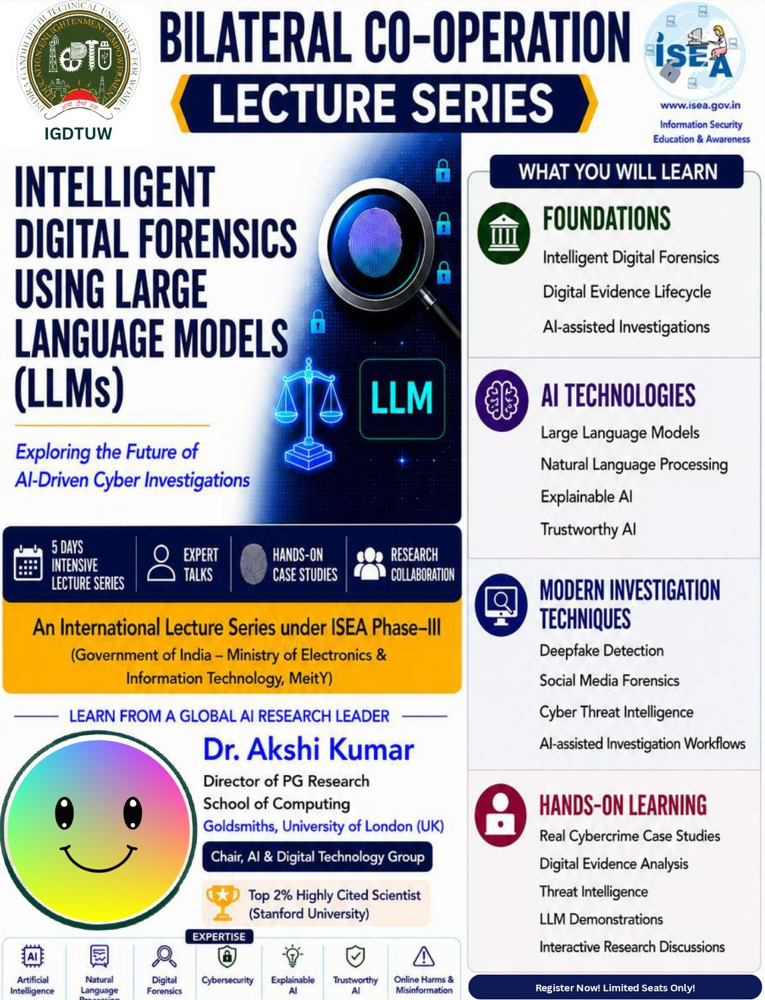

# Digital Forensic Workshop
|Sites|Descricption|
|---|---|
|[ISEA](https://isea.app/events/)|Regulary Conduting Cyber Awareness & Updation Courses|
|[Atal AICTE](https://atalacademy.aicte.gov.in/login)|Regulary Conduting Cyber Awareness & Updation Courses|
|[IGDTUW](https://www.igdtuw.ac.in/student-life/summer-internships)|Individual Portal of particular college/university|

### Fancy Words of Digital Forensic:
|Fancy Words|Definition|
|---|---|
|Victim|person affected by crime|
|Accused|person alleged to have committed a crime|
|Suspect|individual under a police observation|
|Culprit|someone who responsible for committing a crime|

### Digital-Forensic-Workshop

